# 30-Second Demo Recording Script

## Setup (before recording)
1. Install Obscura: `curl -fsSL https://raw.githubusercontent.com/itskum47/obscura/main/install.sh | sh`
2. Add to Claude Desktop config (`~/Library/Application Support/Claude/claude_desktop_config.json`):
   ```json
   {
     "mcpServers": {
       "obscura": { "command": "obscura", "args": ["mcp"] }
     }
   }
   ```
3. Restart Claude Desktop
4. Open QuickTime (Cmd+Shift+5) → record selected portion
5. Set window size to ~700x400 for clean GIF

## Recording (30 seconds)

| Time | Action | What to show |
|------|--------|-------------|
| 0-3s | Open Claude Desktop | Clean window, ready to type |
| 3-8s | Type the query | "Research the latest developments in Rust async runtimes" |
| 8-12s | Press Enter, wait | Claude calls `research_web` tool (show tool call) |
| 12-20s | Wait | Progress: searching, fetching, extracting, ranking |
| 20-28s | Show result | Cited report with sources and claims |
| 28-30s | End | Clean ending on the result |

## Tips
- Use a dark theme for better contrast
- Keep the query short and punchy
- Don't show loading spinners for too long — speed up in post if needed
- Export as GIF (use gifski or ffmpeg: `ffmpeg -i recording.mov -vf "fps=15,scale=700:-1" -loop 0 demo.gif`)
- Save as `assets/demo.gif` and replace the SVG in README

## After recording
```bash
# Convert MOV to GIF
ffmpeg -i recording.mov -vf "fps=15,scale=700:-1:flags=lanczos,split[s0][s1];[s0]palettegen=max_colors=128[p];[s1][p]paletteuse=dither=bayer" -loop 0 assets/demo.gif

# Update README to use GIF instead of SVG
# Replace: 
# With:    

git add assets/demo.gif README.md
git commit -m "docs: add demo GIF"
git push origin main
```