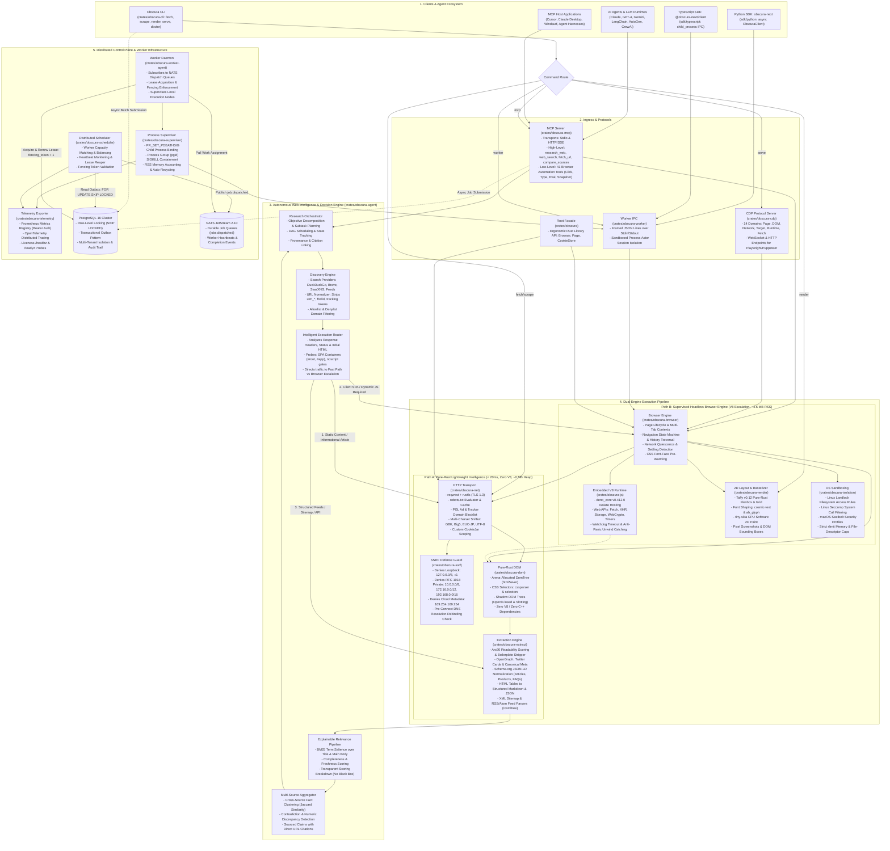

<p align="center">
  
</p>

<h1 align="center">Obscura</h1>

<p align="center">
  <strong>An open-source browser engine for AI agents, web automation, and scraping.</strong><br>
  Built in Rust &bull; Embedded V8 &bull; Native Rendering &bull; Zero Chromium Dependency
</p>

<p align="center">
  <a href="https://github.com/itskum47/obscura/blob/main/LICENSE"></a>
  <a href="https://github.com/itskum47/obscura"></a>
  <a href="https://github.com/itskum47/obscura"></a>
</p>

---

## What Is Obscura?

Obscura is an independent, lightweight browser engine written from scratch in Rust. It embeds Google V8 directly alongside an independent native layout and rasterization engine — no Chromium, no WebDriver, no desktop browser overhead.

It provides a unified set of interfaces for AI agents, programmatic scraping, and browser automation:

- **CLI** — `obscura fetch`, `scrape`, `render`, `serve`, `doctor`
- **MCP Server** — 41 browser tools over stdio and HTTP/SSE for AI agents
- **CDP Server** — Chrome DevTools Protocol over WebSocket for Puppeteer/Playwright
- **Rust Library** — ergonomic `Browser`, `Page`, `CookieStore` API

Obscura is designed for content extraction, agent interaction, and layout verification. It is **not** an Electron wrapper or re-packaged Chromium binary.

---

## Architecture



---

## Key Capabilities

- **Embedded JavaScript Engine:** Executes real-world JavaScript through Google V8 (`deno_core`) with standard ECMAScript semantics, microtask scheduling, and DOM event dispatching.
- **Native Layout & Paint Engine:** Renders pages, captures screenshots, and exports PDFs without Chromium using a dedicated Rust layout tree (Block, Inline, Flexbox, Grid) and 2D rasterizer.
- **AI Agent Automation (MCP):** Implements the Model Context Protocol (MCP) natively over `stdio` and `HTTP/SSE`, providing 41 purpose-built browser automation and extraction tools.
- **CDP Server Compatibility:** Exposes Chrome DevTools Protocol WebSocket endpoints compatible with standard Puppeteer and Playwright automation scripts.
- **Content Extraction:** Pure-Rust readability engine strips navigation, sidebars, and boilerplate. Extracts clean Markdown, metadata (OpenGraph, Twitter Cards, canonical URLs, author, published time), JSON-LD structured data (articles, products, FAQs), tables, and hyperlinks — no V8 overhead.
- **High-Throughput Parallel Scraping:** Built-in multi-process worker pool (`obscura scrape`) designed to extract content across thousands of URLs concurrently with managed memory recycling.
- **Enterprise Isolation & Sandboxing:** Default SSRF protection against private networks, combined with Linux container isolation (namespaces, Landlock LSM, Seccomp-BPF) and macOS Seatbelt confinement.
- **Distributed Control Plane:** PostgreSQL-backed job queue with row-level locking, transactional outbox, NATS JetStream dispatch, lease fencing, and multi-process worker supervision.

---

## Quick Start

### 1. Verify Installation and Engine Health
```bash
obscura doctor
```

### 2. Fetch and Extract Content
```bash
# Convert readable page content to clean Markdown
obscura fetch https://example.com --dump markdown

# Extract all hyperlinks from the document
obscura fetch https://example.com --dump links

# Output rendered DOM HTML
obscura fetch https://news.ycombinator.com --dump html

# Evaluate JavaScript in-page
obscura fetch https://example.com --eval "document.title"
```

### 3. Capture a Screenshot
```bash
obscura fetch https://example.com --screenshot page.png
```

### 4. Run as MCP Server (for AI Agents)
```bash
# stdio transport (Claude Desktop, Cursor, Windsurf)
obscura mcp

# HTTP/SSE transport
obscura mcp --transport http --port 8080
```

### 5. Run as CDP Server (for Puppeteer/Playwright)
```bash
obscura serve --port 9222
```

---

## Demo: Autonomous Web Research via MCP

Connect Obscura to Claude Desktop or any MCP client and ask it to research a topic:

```
You: Research the latest developments in Rust async runtimes

Claude (via Obscura MCP):
  → research_web("rust async runtimes")
  → Searches DuckDuckGo for relevant sources
  → Fetches and extracts content from each source
  → Ranks by BM25 relevance
  → Returns a synthesized report with citations

Result: A cited research report with sources, claims, and contradictions —
all from a self-hosted 4 MB binary. No Chromium. No cloud API. No tokens.

**Example output (abbreviated):**
```json
{
  "report": {
    "objective": "rust programming language",
    "executive_summary": "Synthesis across 3 consulted sources... Key consensus indicates: Rust is blazingly fast and memory-efficient...",
    "verified_claims": [
      { "statement": "Rust enforces memory safety without a garbage collector", "consensus_count": 2, "citations": [...] }
    ],
    "sources": [
      { "url": "https://www.rust-lang.org/", "title": "Official site", "relevance_score": 0.92, "retrieval_method": "http" },
      { "url": "https://en.wikipedia.org/wiki/Rust_(programming_language)", "title": "Rust (programming language)", "relevance_score": 0.87, "retrieval_method": "http" }
    ],
    "contradictions": [],
    "limitations": []
  },
  "http_retrieval_count": 3,
  "elapsed_ms": 4200
}
```

**Try it yourself:**
```bash
# 1. Install
curl -fsSL https://raw.githubusercontent.com/itskum47/obscura/main/install.sh | sh

# 2. Add to Claude Desktop config
# macOS: ~/Library/Application Support/Claude/claude_desktop_config.json
# {
#   "mcpServers": {
#     "obscura": { "command": "obscura", "args": ["mcp"] }
#   }
# }

# 3. Ask Claude: "Research the latest developments in Rust async runtimes"
```

---

## Installation

### One-Line Install (macOS / Linux)
```bash
curl -fsSL https://raw.githubusercontent.com/itskum47/obscura/main/install.sh | sh
```

### Windows (PowerShell)
```powershell
irm https://raw.githubusercontent.com/itskum47/obscura/main/install.ps1 | iex
```

### From Source
```bash
git clone https://github.com/itskum47/obscura.git
cd obscura
cargo build --release
```

---

## Performance

| Metric | Obscura | Headless Chromium |
|--------|---------|-------------------|
| Startup latency | ~8.5 ms | ~500 ms+ |
| Memory (idle) | ~4.3 MB RSS | ~150–300 MB |
| Memory (active session) | ~4.6 MB RSS | ~200–400 MB |
| 8 concurrent workers | ~37 MB total | ~1.2–2.4 GB |
| HTML parse (50 KB) | ~24 ms | ~50–100 ms |

*Obscura runs a full V8 isolate + Rust DOM in ~4 MB. No Chromium, no WebDriver, no desktop browser overhead.*

---

## SDKs

### Python
```python
from obscura_next import ObscuraClient

async with ObscuraClient() as client:
    await client.navigate("https://example.com")
    title = await client.eval("document.title")
    print(title)
```

### TypeScript / Node.js
```typescript
import { ObscuraClient } from "@obscura-next/client";

const client = new ObscuraClient();
await client.start();
await client.navigate("https://example.com");
const title = await client.eval("document.title");
console.log(title);
await client.stop();
```

---

## Documentation

| Guide | Description |
|-------|-------------|
| [Installation](docs/Installation.md) | Detailed installation across all platforms |
| [CLI Reference](docs/CLI-reference.md) | Full command and flag reference |
| [MCP Server](docs/Use-the-MCP-server.md) | MCP setup for Claude, Cursor, Windsurf |
| [CDP Integration](docs/Connect-Puppeteer-or-Playwright.md) | Puppeteer/Playwright connection guide |
| [Extract Data](docs/Extract-data.md) | Content extraction and structured data |
| [Markdown Extraction](docs/Markdown-extraction.md) | Markdown output formats |
| [Build from Source](docs/Build-from-source.md) | Compiling from source |
| [Architecture](docs/Architecture-overview.md) | System architecture overview |
| [Environment Variables](docs/Environment-variables.md) | Configuration reference |

---

## Project Structure

```
obscura-next/
├── crates/
│   ├── obscura-dom/          # Pure-Rust DOM (html5ever, CSS selectors)
│   ├── obscura-net/          # HTTP transport, SSRF, cookies, robots.txt
│   ├── obscura-ssrf/         # SSRF deny-set & private network validation
│   ├── obscura-browser/      # Page lifecycle, V8 isolate integration
│   ├── obscura-js/           # Embedded V8 runtime (deno_core)
│   ├── obscura-cdp/          # Chrome DevTools Protocol server
│   ├── obscura-mcp/          # Model Context Protocol server
│   ├── obscura-render/       # Taffy layout + tiny-skia rasterizer
│   ├── obscura-extract/      # Readability, JSON-LD, metadata, tables, links, feeds
│   ├── obscura-agent/        # Research orchestrator, relevance, routing, aggregation
│   ├── obscura-cli/          # CLI binary (fetch, scrape, serve, mcp, doctor)
│   ├── obscura/              # Root facade library
│   ├── obscura-telemetry/    # Prometheus metrics, OpenTelemetry tracing
│   ├── obscura-isolation/    # OS sandboxing (Landlock, Seccomp, Seatbelt)
│   ├── obscura-worker/       # Worker process & session isolation
│   ├── obscura-supervisor/   # Process supervision tree
│   ├── obscura-control-plane/# PostgreSQL control plane
│   ├── obscura-scheduler/    # Distributed job scheduler
│   └── obscura-worker-agent/ # NATS worker daemon
├── sdk/
│   ├── python/               # Python SDK (async/sync)
│   └── typescript/           # TypeScript/Node.js SDK
├── docs/                     # Documentation
├── deploy/                   # Docker & deployment configs
└── tests/                    # Integration test harnesses
```

---

## Contributing

Contributions are welcome. Please see [CONTRIBUTING.md](CONTRIBUTING.md) for guidelines.

## License

Obscura is licensed under the [Apache License 2.0](LICENSE).

---

<p align="center">
  Built with 🦀 Rust &bull; Embedded V8 &bull; Zero Chromium
</p>