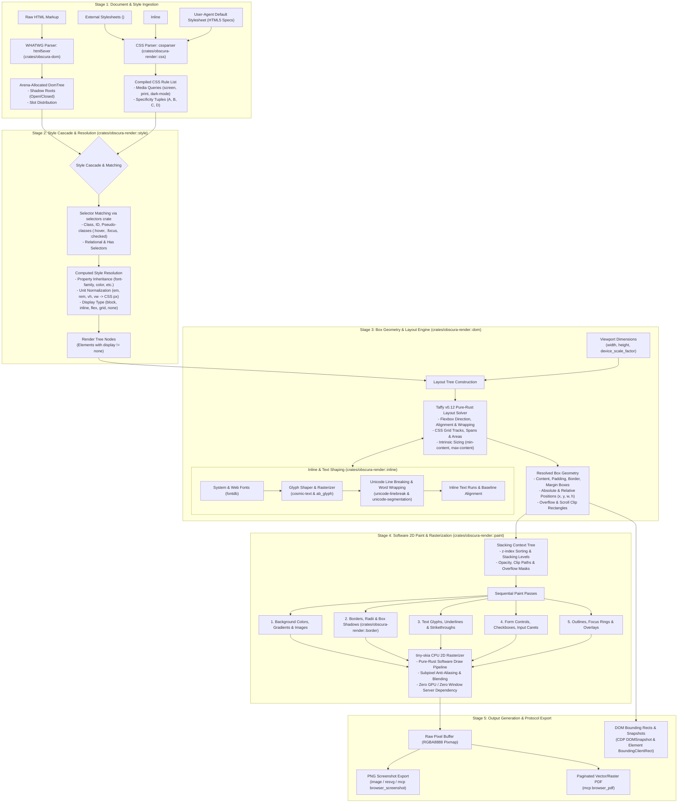

# Obscura — Complete Rendering & Execution Flowcharts

---

## 1. Pure-Rust Visual Rendering & Rasterization Pipeline (`obscura-render`)

This flowchart details how Obscura transforms an HTML document, CSS stylesheets, and DOM mutations into a 2D software-rasterized framebuffer, screenshot, or PDF without Chromium or GPU dependencies.



---

## 2. Dual-Engine Intelligent Execution Router Flowchart (`obscura-agent::router`)

This flowchart details how Obscura dynamically routes incoming web requests between the **sub-20ms Pure-Rust Fast Path** and the **Supervised V8 Browser Escalation Path**.

```mermaid
flowchart TD
    %% ==========================================
    %% REQUEST INTAKE
    %% ==========================================
    Req["Incoming Web Request / Target URL"] --> Net_Probe["Fast HTTP Network Probe\n(crates/obscura-net: reqwest + rustls)"]
    
    Net_Probe --> SSRF_Check{"SSRF Guard Check\n(crates/obscura-ssrf)"}
    SSRF_Check -->|Private / Loopback / Metadata IP| Deny["403 Forbidden: Blocked by SSRF Policy"]
    
    SSRF_Check -->|Permitted Public Host| Fetch_Response["Receive Response Status, Headers & First Chunk"]
    
    %% ==========================================
    %% CONTENT-TYPE INSPECTION
    %% ==========================================
    Fetch_Response --> Type_Check{"Inspect Content-Type & Payload"}
    
    Type_Check -->|application/json| Direct_JSON["Direct API Processing\n- Zero DOM, Zero V8\n- Latency: < 10ms\n- Memory: ~0 MB"]
    Type_Check -->|text/xml, application/rss+xml, sitemap.xml| Feed_Parser["Feed & Sitemap Parser\n(crates/obscura-extract::feeds)\n- roxmltree Parsing\n- Latency: < 15ms"]
    Type_Check -->|text/html| HTML_Analysis["DOM & Marker Analysis\n(crates/obscura-agent::router)"]
    
    %% ==========================================
    %% SPA & DYNAMIC CONTENT PROBING
    %% ==========================================
    HTML_Analysis --> SPA_Probe{"Evaluate Dynamic SPA Indicators"}
    
    SPA_Probe -->|SPA Shell Detected: id='root', id='app', app-root| Text_Density{"Check Static Text Volume"}
    SPA_Probe -->|noscript Block: 'Enable JavaScript'| Escalate_JS["Escalation Required:\nJavaScript Execution Mandatory"]
    SPA_Probe -->|Standard Informational HTML| Substantive_Check{"Substantive Text > 300 Chars?"}
    
    Text_Density -->|Text < 250 Chars AND Scripts >= 2| Escalate_JS
    Text_Density -->|Rich Pre-rendered Text Found (SSR / Next.js / Astro)| Fast_Path["Fast Path Approved:\nStatic Content Fully Present"]
    
    Substantive_Check -->|Yes: News, Article, Docs, Wiki, Blog| Fast_Path
    Substantive_Check -->|No: Empty Skeleton or Obfuscated Shell| Escalate_JS
    
    %% ==========================================
    %% EXECUTION PATHS
    %% ==========================================
    subgraph FAST_PIPELINE["Path A: Pure-Rust Lightweight Intelligence (< 20ms)"]
        Fast_Path --> Pure_DOM["Pure-Rust DOM Parse: html5ever\n(crates/obscura-dom)"]
        Pure_DOM --> Extract_Engine["Unified Extractor (crates/obscura-extract)\n- Arc90 Readability Algorithm\n- OpenGraph & Twitter Cards\n- JSON-LD Schema.org Structuring\n- HTML Tables to Markdown & JSON"]
        Extract_Engine --> Fast_Output["Clean Evidence-Backed Markdown & Data"]
    end
    
    subgraph BROWSER_PIPELINE["Path B: Supervised Headless Browser (V8 Escalation)"]
        Escalate_JS --> Spawn_Worker["Spawn Sandboxed Worker Process\n(crates/obscura-supervisor + obscura-isolation)"]
        Spawn_Worker --> Page_Navigate["Load Page in V8 Runtime (crates/obscura-js)\n- Execute Client-Side React/Vue Hydration\n- Wait for Network Quiescence (networkidle0)\n- Trigger Timers & DOM Mutation Observers"]
        Page_Navigate --> Browser_Snapshot["Semantic DOM Distillation / Snapshot\n(crates/obscura-agent: SemanticDistiller)"]
        Browser_Snapshot --> Browser_Output["Rendered Dynamic DOM & Interactive State"]
    end
    
    %% Output Convergence
    Fast_Output --> Final_Delivery["Relevance Scoring & Multi-Source Synthesis"]
    Browser_Output --> Final_Delivery
    Direct_JSON --> Final_Delivery
    Feed_Parser --> Final_Delivery
```
