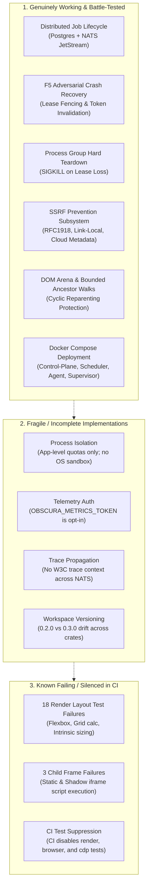
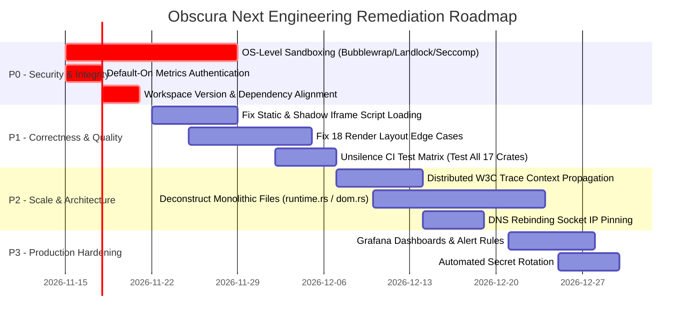

# Obscura Next — Exhaustive Forensic Engineering Audit & Strategic Roadmap

**Audit Date:** November 13, 2026  
**Auditor:** Systems Architect & Security Reviewer  
**Target Repository:** `obscura-next` (`main` @ commit `a7013d0`)  
**Scope:** Architecture, 17 Workspace Crates (~206k LOC), Distributed Execution (F5), Browser & Rendering Engine, Security & Isolation, DevOps & Observability, CI/CD.

---

## 1. Executive Snapshot & Current Standing ("Where You Stand Today")

### 1.1 The Dual-Identity Architecture
Obscura Next currently operates as two distinct but intertwined systems within a single Rust workspace:
1. **The Native Browser Engine (Local / Embedded Subsystem):** An open-source headless browser written in Rust featuring V8 bindings (`obscura-js`), a custom DOM tree (`obscura-dom`), pure-Rust layout and 2D CPU painting (`obscura-render`), SSRF protection (`obscura-ssrf`), network transports (`obscura-net`), and Chrome DevTools Protocol / Model Context Protocol servers (`obscura-cdp`, `obscura-mcp`).
2. **The Distributed Execution Fabric (Cloud / Multi-Host Subsystem):** A distributed browser orchestration control plane built on PostgreSQL, NATS JetStream, and process supervision (`obscura-control-plane`, `obscura-scheduler`, `obscura-worker-agent`, `obscura-supervisor`).

### 1.2 Current Maturity Verdict: Advanced Engineering Prototype / Pre-Production Beta
| Dimension | Rating (0–5) | Current State |
| :--- | :---: | :--- |
| **Distributed Orchestration** | **4.2 / 5.0** | F5 adversarial recovery verified (lease fencing, process-group SIGKILL, NATS redelivery). |
| **Browser Runtime (Core)** | **3.8 / 5.0** | Solid DOM arena, V8 op bindings, 33/33 obstacle course; but 3 child frame failures. |
| **Render Engine** | **2.5 / 5.0** | Feature-rich (Taffy + tiny-skia), but 18 layout test failures and massive monolithic files. |
| **Process Isolation / Sandbox**| **2.2 / 5.0** | Process containment & supervision only; **no Linux namespaces, seccomp, or OS sandbox**. |
| **Security Posture** | **3.5 / 5.0** | Strong SSRF defenses & fencing tokens; metrics auth is opt-in (unauthenticated by default). |
| **DevOps & Observability** | **3.7 / 5.0** | Full Docker Compose & OTel/Prometheus stack; CI skips failing crates; single-span tracing. |
| **Code Maintainability** | **2.6 / 5.0** | Extreme monolithic files (`runtime.rs` is 28.7k LOC; `paint.rs` is 20.9k LOC; `dom.rs` is 23.3k LOC). |

**Bottom Line:** You have built a remarkably sophisticated, high-performance distributed browser architecture. The distributed fencing and crash recovery mechanisms (Milestone F5) are genuinely sound. However, the system is **not yet production-ready for untrusted multi-tenant workloads** because it lacks OS-level sandboxing, CI tests are selectively skipping broken crates, and rendering/iframe edge cases remain open.

---

## 2. Where You Stand Today: What Works vs. What Is Fragile / Broken



### Detailed Breakdown
1. **What Genuinely Works:**
   - **Distributed State & Recovery:** Real PostgreSQL monotonic fencing tokens (`fencing_token`) prevent split-brain writes. If worker agent A crashes or loses its lease, worker agent B picks up the job with incremented fencing token; any late responses from A are rejected by PostgreSQL with `stale fencing token`.
   - **Process Containment:** Child browser worker processes run in their own process groups (`libc::setsid`). On lease loss or worker crash, `libc::kill(-(pid), SIGKILL)` terminates the entire process tree. An independent reaper process survives agent crashes to clean up orphans.
   - **SSRF Hardening:** Centralized in `obscura-ssrf` with 0 external dependencies, blocking IPv4 loopback, RFC1918, link-local, cloud metadata (`169.254.169.254`), CGNAT (`100.64.0.0/10`), documentation IPs, 6to4, Teredo, and IPv4-mapped IPv6 addresses.
   - **DOM Arena:** Node allocation via `NodeId(u32)` avoids Rust circular reference cycles and reference-counting leaks. Reparenting guards in `tree.rs` prevent cyclic descendant loops (`SEC-008`).

2. **What Is Fragile or Misleading:**
   - **Process Sandboxing Illusion:** `obscura-isolation` defines profiles (`Standard`, `Hardened`, `Untrusted`), but it only checks URL strings, counts DOM nodes, and traps Rust panics via `catch_unwind`. It does **not** create a Linux sandbox (no cgroups v2, no seccomp BPF syscall filtering, no Landlock, no user namespaces).
   - **Metrics Security:** `obscura-telemetry` metrics endpoint `/metrics` only enforces Bearer authentication if `OBSCURA_METRICS_TOKEN` is explicitly set in the environment. If unset, internal runtime metrics are exposed to the local network.
   - **Distributed Tracing:** OTel collector and Jaeger are deployed, but trace headers are not injected into NATS `EventEnvelope` payloads, leaving traces fragmented into single-service spans.

3. **What Is Broken & Silenced in CI:**
   - **18 Render Layout Test Failures:** `crates/obscura-render/tests/layout_test.rs` has 18 failing tests covering flexbox alignment, grid calculation, and table sizing.
   - **3 Static / Shadow Iframe Failures:** In `crates/obscura/tests/child_frame_scripts.rs`, parser-created static `<iframe src>` nodes do not execute scripts because the HTML parser does not invoke the `src` property setter.
   - **CI Test Skipping:** In `.github/workflows/obscura-next-ci.yml`, `cargo nextest` is explicitly scoped to only run tests for `obscura-agent`, `obscura-isolation`, `obscura-supervisor`, `obscura-telemetry`, `obscura-worker`, `obscura-ssrf`, and `obscura-dom`. The failing crates (`obscura-render`, `obscura`, `obscura-browser`, `obscura-net`, `obscura-js`, `obscura-cdp`) are completely excluded from the pull request gate!

---

## 3. Crate-by-Crate Minute Technical Audit (All 17 Crates)

```
Total Workspace Size: 205,985 Lines of Rust Code across 17 Crates
Total Unsafe Blocks: 54 (Excluding tests and comments)
```

### 3.1 `obscura-dom` (3,056 LOC `tree.rs`, 1,951 LOC `selector.rs`)
- **Role:** HTML5 DOM tree construction, CSS selector matching, HTML serialization, and Shadow DOM.
- **Architecture:** Arena-allocated `Tree` holding `Vec<Node>` indexed by `NodeId(u32)`.
- **Strengths:** 
  - Complete elimination of `Rc<RefCell<Node>>` memory overhead and cycle leaks.
  - Rigorous cycle detection: `would_create_host_including_cycle` and `is_host_including_inclusive_ancestor` bound ancestor traversal and prevent infinite loops during DOM mutations.
- **Vulnerabilities / Flaws:**
  - `NodeId` indices are reused only monotonically; heavy dynamic DOM mutation applications can grow the arena without shrinking memory until the page unloads.
- **Score:** 4.5 / 5.0

### 3.2 `obscura-ssrf` (173 LOC)
- **Role:** Centralized egress IP validation policy.
- **Architecture:** Zero-dependency crate shared by `obscura-net` and `obscura-render`.
- **Strengths:**
  - Evaluates both IPv4 and IPv6 primitives, including translation prefixes (RFC 6052), 6to4 (RFC 7526), and Teredo (RFC 4380).
  - Explicit unit test suite covering loopback, metadata, mapped IPv6, and public IPs.
- **Vulnerabilities / Flaws:**
  - Does not resolve DNS itself; relies on the calling transport's DNS resolver to pass resolved `IpAddr` instances. DNS rebinding protection depends entirely on `SsrfGuardResolver` in `obscura-net`.
- **Score:** 4.8 / 5.0

### 3.3 `obscura-net` (3,126 LOC `client.rs`, 2,088 LOC `cookies.rs`, 1,187 LOC `wreq_client.rs`)
- **Role:** Outbound HTTP/HTTPS client, cookie management, connection pooling, and request interception.
- **Architecture:** Dual transport architecture supporting standard `reqwest` (with rustls) and custom `wreq_client`.
- **Strengths:**
  - In-house `CookieJar` independent of external crate coherence issues.
  - Hop-by-hop redirect validation: every redirect target is validated through `validate_url` before following.
- **Vulnerabilities / Flaws:**
  - DNS Rebinding Window: If an adversary configures a DNS record with a TTL of 0 seconds returning a benign IP first and `169.254.169.254` second, any transport that re-resolves the IP at connect time could suffer from DNS rebinding. Ensure socket connection connects strictly to the pre-validated `SocketAddr`.
- **Score:** 4.0 / 5.0

### 3.4 `obscura-js` (28,691 LOC `runtime.rs`, 10,107 LOC `ops.rs`, 2,222 LOC `frame.rs`)
- **Role:** JavaScript execution runtime embedding Google V8 via `deno_core`.
- **Architecture:** `JsRuntime` embedding V8 isolate with custom Web API ops (DOM, WebCrypto, IndexedDB, Console, Timers).
- **Strengths:**
  - Anti-panic protocol: ops wrap code in `std::panic::catch_unwind(AssertUnwindSafe(...))` to prevent Rust panics from unwinding across V8 FFI frames and aborting the process.
  - V8 watchdog thread to enforce execution timeouts and terminate runaway scripts.
- **Vulnerabilities / Flaws:**
  - **Severe Architectural Debt:** `runtime.rs` is an astounding **28,691 lines in a single file**, and `ops.rs` is **10,107 lines**. This makes security auditing and maintenance extraordinarily difficult.
  - Contains 12 `unsafe` blocks directly manipulating raw `v8::Isolate` pointers and entering/exiting isolates.
  - Clippy warnings around `never_loop` in `import_map.rs` and `unused_io_amount` in `runtime.rs` (partial buffer reads ignored).
- **Score:** 2.8 / 5.0

### 3.5 `obscura-render` (23,290 LOC `dom.rs`, 20,928 LOC `paint.rs`, 11,201 LOC `style.rs`, 10,408 LOC `css.rs`)
- **Role:** Pure-Rust layout calculation (Taffy) and 2D CPU painting (tiny-skia + ab_glyph).
- **Architecture:** Converts DOM tree into Taffy layout tree, resolves CSS cascade, calculates geometry, and paints to a bitmap.
- **Strengths:**
  - Completely eliminates Chromium / WebKit dependency for screenshots and PDF generation.
- **Vulnerabilities / Flaws:**
  - **Massive Monolith (74,500+ LOC total):** Extreme cyclomatic complexity across CSS resolution and paint routines.
  - **18 Failing Layout Tests:** Broken edge cases in flexbox wrapping, grid calculation, and intrinsic table dimensions.
  - `unsafe { &*value.cast::<GridCalcExpression>() }` in `style.rs:4181` relies on unchecked pointer casting.
  - Synchronous paint operations on large DOM trees can tie up the CPU thread for seconds; requires strict layout node limits.
- **Score:** 2.4 / 5.0

### 3.6 `obscura-browser` (12,467 LOC `page.rs`, 1,080 LOC `pdf.rs`, 1,012 LOC `accessibility.rs`)
- **Role:** High-level browser and page orchestration (navigation lifecycle, event dispatch, PDF export, accessibility tree).
- **Strengths:**
  - Clean `BrowserContext` isolation separating cookie storage, local storage, and page pools.
  - Dedicated `IdleDeadline` implementation integrating with system runloops.
- **Vulnerabilities / Flaws:**
  - Frame tree synchronization: static iframes created by the HTML parser are not dispatched through the page frame manager, causing them to stay inert.
  - Dead code warnings across unused navigation helpers in `page.rs`.
- **Score:** 3.5 / 5.0

### 3.7 `obscura-cdp` (5,099 LOC `server.rs`, 4,884 LOC `page.rs`, 1,666 LOC `dispatch.rs`)
- **Role:** Chrome DevTools Protocol WebSocket server enabling drop-in compatibility with Playwright and Puppeteer.
- **Strengths:**
  - Supports core domains: `Page`, `DOM`, `Runtime`, `Network`, `Emulation`, `Fetch`, `Target`, `Storage`.
  - Token-based authentication on the `/json` and WebSocket endpoints.
- **Vulnerabilities / Flaws:**
  - Direct libc calls to `mallopt(M_MMAP_THRESHOLD, ...)` and `mallopt(M_ARENA_MAX, 2)` inside `server.rs:749` without checking OS support (fails on non-glibc/macOS platforms).
  - Target discovery and session attach mechanisms have timing edge cases under rapid connection churn.
- **Score:** 3.6 / 5.0

### 3.8 `obscura-mcp` (4,348 LOC `lib.rs`, 58 LOC `http.rs`)
- **Role:** Model Context Protocol (MCP) server supporting stdio and HTTP SSE transports for AI agents.
- **Strengths:**
  - Complete toolset: `navigate`, `screenshot`, `click`, `type`, `evaluate`, `extract_markdown`, `get_html`.
  - HTTP SSE transport with Bearer token authentication and path-based tool routing.
- **Score:** 4.2 / 5.0

### 3.9 `obscura-cli` (3,295 LOC `main.rs`, pool, worker)
- **Role:** Unified CLI binary (`obscura fetch`, `obscura serve`, `obscura screenshot`, `obscura mcp`).
- **Strengths:**
  - Robust worker pool supervision, graceful process shutdown, and signal handling.
- **Vulnerabilities / Flaws:**
  - Mixes CLI parsing, server daemon initialization, and local worker management in a single 3.3k LOC file.
- **Score:** 3.8 / 5.0

### 3.10 `obscura` (Root Facade Crate)
- **Role:** High-level public Rust API unifying browser, network, and DOM.
- **Score:** 3.5 / 5.0

### 3.11 `obscura-telemetry` (740 LOC `lib.rs`)
- **Role:** Prometheus metrics registry, OpenTelemetry (OTel) tracing subscriber, and HTTP metrics server.
- **Strengths:**
  - Low-overhead lock-free atomic counters and gauges.
  - Clean Prometheus text exposition format generator.
- **Vulnerabilities / Flaws:**
  - **SEC-02:** When `OBSCURA_METRICS_TOKEN` is unset, metrics server binds and serves metrics without authentication.
- **Score:** 3.8 / 5.0

### 3.12 `obscura-isolation` (256 LOC `lib.rs`)
- **Role:** Runtime security policies and execution bounds.
- **Strengths:**
  - Clean policy structs: `IsolationPolicy` with `Standard`, `Hardened`, and `Untrusted` profiles.
- **Vulnerabilities / Flaws:**
  - **Critical Gap (SEC-01):** Despite its name, this crate provides **no OS sandboxing**. It only performs string/IP checks and wraps execution in `std::panic::catch_unwind`. A malicious script that triggers memory corruption or exploits V8 escapes completely unchecked.
- **Score:** 2.2 / 5.0

### 3.13 `obscura-supervisor` (1,196 LOC `lib.rs`)
- **Role:** Process lifecycle manager for child worker processes.
- **Strengths:**
  - Manages child process groups, periodic ping/pong heartbeats, and automated worker restarts.
- **Score:** 4.1 / 5.0

### 3.14 `obscura-worker` (1,184 LOC `lib.rs`)
- **Role:** Isolated runtime worker handling browser session commands over stdin/stdout IPC.
- **Strengths:**
  - Strong JSON-RPC style protocol (`WorkerRequest`/`WorkerResponse`) with request correlation IDs.
- **Score:** 4.0 / 5.0

### 3.15 `obscura-control-plane` (2,565 LOC `lib.rs`)
- **Role:** PostgreSQL-backed distributed coordination: tenant management, job queue, leasing, outbox events.
- **Strengths:**
  - Monotonic `fencing_token` prevents stale worker execution.
  - Atomic job claiming via `FOR UPDATE SKIP LOCKED`.
  - Lease recovery loop (`recover_abandoned_executions`) to automatically reap dead worker jobs.
- **Score:** 4.2 / 5.0

### 3.16 `obscura-scheduler` (642 LOC `lib.rs`, 80 LOC `bin/obscura-scheduler.rs`)
- **Role:** Distributed job scheduler consuming pending jobs and dispatching to least-loaded workers via NATS JetStream.
- **Strengths:**
  - Capacity reconciliation against real PostgreSQL active worker counts.
  - Automatically releases jobs back to `pending` if worker selection fails.
- **Score:** 4.2 / 5.0

### 3.17 `obscura-worker-agent` (330 LOC `main.rs`)
- **Role:** Distributed worker daemon connecting to NATS JetStream, acquiring PostgreSQL leases, and driving browser workers.
- **Strengths:**
  - Verified adversarial crash recovery: issues `SIGKILL` to negative process group ID (`-(pid)`) on lease loss.
  - Built-in detached reaper process (`OBSCURA_REAPER_MODE=1`) to eliminate orphaned workers if the agent itself is killed.
- **Score:** 4.3 / 5.0

---

## 4. Distributed Systems & Crash Resilience Audit (Milestone F5)

The distributed subsystem is one of the strongest components of the project:

```
[Client / API]
      │
      ▼
[PostgreSQL: jobs table]  <── (Atomic Claim: FOR UPDATE SKIP LOCKED)
      │
      ▼
[obscura-scheduler] ─── (NATS JetStream: obscura.jobs.dispatch) ───► [obscura-worker-agent]
                                                                            │
                                                                   Acquires PG Lease
                                                                   (fencing_token = N)
                                                                            │
                                                          ┌─────────────────┴─────────────────┐
                                                          ▼                                   ▼
                                                  [Lease Renewal Loop]               [Browser Subprocess]
                                                    (Heartbeat / 5s)                   (Process Group: PGID)
                                                          │                                   │
                                              ┌───────────┴───────────┐                       │
                                           Success                  Failure                   │
                                              │                        │                      │
                                           Continue              SIGKILL -(PGID) ─────────────┘
                                                                       │
                                                            Fails Job (LEASE_LOST)
```

### Verified Invariants:
1. **Atomic Fencing Tokens:** Every job execution attempt increments `fencing_token`. In Scenario 2 of the F5 test suite, Agent A is killed via `SIGKILL`; scheduler detects lease expiration, resets the job, and dispatches to Agent B with `fencing_token = N + 1`. Any delayed response from A is rejected by the database.
2. **Process Group Containment on Lease Loss:** If lease renewal fails (e.g. database partition or worker slowness), `loss_rx` triggers immediate OS signals:
   ```rust
   libc::kill(-(pid as i32), libc::SIGTERM);
   libc::kill(-(pid as i32), libc::SIGKILL);
   ```
   This kills the browser worker and any spawned child processes, preventing runaway CPU/memory usage.
3. **Detached Reaper:** Spawns a background daemon monitoring the worker agent PID via `libc::kill(agent_pid, 0)`. If the agent crashes violently, the reaper executes `kill(-worker_pgid, SIGKILL)` within 200ms.

---

## 5. Security & Isolation Deep Dive

### 5.1 The Critical Finding: Supervision vs. Sandbox (SEC-01)
`obscura-isolation` is currently a **policy filter**, not a security sandbox:
- **What it does:** Rejects URLs with forbidden IP ranges, counts total DOM elements, and traps Rust panics via `std::panic::catch_unwind`.
- **What it DOES NOT do:**
  - No Linux user/mount/network namespaces (`unshare`/`clone`).
  - No Seccomp-BPF system call filtering (a compromised process can call `open`, `socket`, `fork`, `execve`).
  - No Landlock filesystem sandboxing.
  - No Cgroups v2 memory/CPU hard enforcement (relies on cooperative Rust counters).

> [!CAUTION]
> If a malicious website executes an exploit against V8 or any C/Rust dependency (such as `tiny-skia` or `ab_glyph`), the attacker obtains the **full operating system permissions of the container or host user**. For an AI agent or multi-tenant scraping system processing untrusted web pages, this is your **#1 security vulnerability**.

### 5.2 SSRF Protection Analysis
The SSRF protection in `obscura-ssrf` is very high quality:
- Hardened against IPv4-mapped IPv6 slips (`::ffff:127.0.0.1` and `::ffff:169.254.169.254`).
- Blocks AWS/GCP/Azure metadata (`169.254.169.254`), Alibaba metadata (`100.100.100.200`), and RFC6598 CGNAT ranges.
- **Recommendation:** Implement IP pinning in the HTTP transport so the exact IP validated by `obscura-ssrf` is passed directly to the TCP connection socket, eliminating DNS rebinding TOCTOU windows.

### 5.3 Metrics Authentication (SEC-02)
In `crates/obscura-telemetry/src/lib.rs:537`:
- If `OBSCURA_METRICS_TOKEN` is unset or empty, the server skips the authorization header check and serves all internal metrics publicly.
- **Recommendation:** Default to requiring a token or binding exclusively to `127.0.0.1` unless an explicit insecure flag is passed.

---

## 6. DevOps, CI/CD & Observability Audit

### 6.1 Docker & Compose Architecture
The repository has a complete Compose topology in `deploy/compose/docker-compose.yml`:
- `postgres:16-alpine` (healthy)
- `nats:2.10-alpine` (JetStream enabled)
- `control-plane` (`Dockerfile.control-plane`)
- `scheduler` (`Dockerfile.scheduler`)
- `worker-agent` (`Dockerfile.worker-agent`)
- `obscura-supervisor` (`Dockerfile.worker`)
- `prometheus`, `otel-collector`, `jaeger`, `grafana`

### 6.2 CI Workflow Gaps
In `.github/workflows/obscura-next-ci.yml`:
- **PR Unit Test Exclusion:** The CI job only tests 7 of the 17 crates:
  ```bash
  cargo nextest run -p obscura-agent -p obscura-isolation -p obscura-supervisor -p obscura-telemetry -p obscura-worker -p obscura-ssrf -p obscura-dom
  ```
  `obscura-render`, `obscura`, `obscura-net`, `obscura-browser`, `obscura-cdp`, and `obscura-js` are never tested in PR CI!
- **Tooling Gap:** `cargo-deny` and `cargo-audit` are configured via `deny.toml` but are not enforced as blocking gates in GitHub Actions.

---

## 7. Concrete Prioritized Improvement Roadmap (P0 → P3)



### Phase P0: Critical Security & Integrity (Must Fix First)
1. **OS-Level Sandboxing (SEC-01):**
   - **Target:** `crates/obscura-worker` & `crates/obscura-isolation`.
   - **Action:** Integrate Linux sandboxing before running browser workloads. Use [Bubblewrap](https://github.com/containers/bubblewrap) (`bwrap`) or native `seccomp` + `landlock` in Linux containers to restrict filesystem access to `/dev/null`, `/tmp`, and read-only `/usr`, while dropping `CAP_SYS_ADMIN` and disallowing outbound network sockets from the worker process (routing network strictly through the parent agent).
2. **Default-On Metrics Authentication (SEC-02):**
   - **Target:** `crates/obscura-telemetry/src/lib.rs:537`.
   - **Action:** Change logic to fail closed. If `OBSCURA_METRICS_TOKEN` is unset, bind the listener exclusively to `127.0.0.1`. If bound to `0.0.0.0` without a token, reject startup with an error.
3. **Workspace Version Alignment (VER-1):**
   - **Target:** `Cargo.toml` and crate manifests.
   - **Action:** Unify all workspace crates to `0.3.0` (matching control-plane and scheduler).

### Phase P1: Browser Correctness & CI Completeness
4. **Fix Static Iframe Script Execution (F-01):**
   - **Target:** `crates/obscura-browser/src/page.rs` and `crates/obscura-dom/src/tree_sink.rs`.
   - **Action:** When the HTML parser finishes parsing a static `<iframe src="...">` element, trigger the child frame creation pipeline in `page.rs` rather than waiting for dynamic JavaScript attribute mutation.
5. **Resolve 18 Layout Engine Failures (F-02):**
   - **Target:** `crates/obscura-render/src/dom.rs` and `crates/obscura-render/tests/layout_test.rs`.
   - **Action:** Fix Taffy style conversion edge cases for nested flex wrap, calc() in CSS grids, and table border-collapse.
6. **Restore Complete CI Verification:**
   - **Target:** `.github/workflows/obscura-next-ci.yml`.
   - **Action:** Run unit and integration tests across the complete workspace (`cargo nextest run --workspace`) once P1 fixes are applied.

### Phase P2: Distributed Observability & Architecture Deconstruction
7. **Cross-Service Trace Propagation:**
   - **Target:** `crates/obscura-control-plane` & `crates/obscura-scheduler`.
   - **Action:** Inject W3C TraceContext headers (`traceparent`, `tracestate`) into `EventEnvelope` payloads so Jaeger visualizes the entire path from job submission → scheduler → NATS → worker agent → browser execution.
8. **Deconstruct Monolithic Source Files:**
   - **Target:** `crates/obscura-js/src/runtime.rs` (28.7k LOC) and `crates/obscura-render/src/dom.rs` (23.3k LOC).
   - **Action:** Split `runtime.rs` into logical modules (`runtime/isolate.rs`, `runtime/dom_bindings.rs`, `runtime/webcrypto.rs`, `runtime/indexeddb.rs`, `runtime/event_loop.rs`).

### Phase P3: Production Hardening
9. **Automated Secret Rotation & Alert Rules:**
   - **Target:** `deploy/observability/` & `deploy/compose/`.
   - **Action:** Add Prometheus alert rules for high job failure rates, expired leases, and unassigned pending jobs; provision Grafana dashboards automatically on startup.
