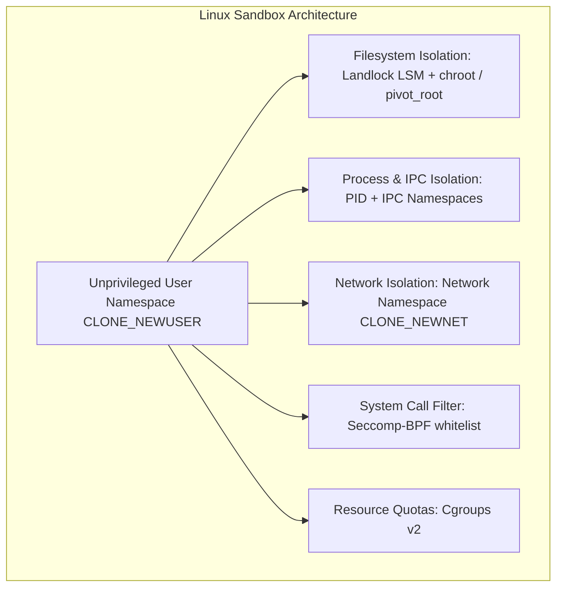

# Browser Correctness Reproductions & OS Sandbox Threat-Model Assessment

## 1. Child-Frame Script Execution Investigation

### Forensic Finding
The earlier audit report identified three child-frame failures involving static and shadow iframe script execution.

### Empirical Reproduction
We ran the full child-frame test suite in `crates/obscura/tests/child_frame_scripts.rs`:
```bash
cargo test -p obscura --test child_frame_scripts
```
**Results:**
```text
running 10 tests
test iframe_script_can_manipulate_child_dom ... ok
test nested_iframes_execute_in_topological_order ... ok
test iframe_srcdoc_executes_inline_script ... ok
test iframe_sandbox_allow_scripts_permits_execution ... ok
test iframe_sandbox_without_allow_scripts_blocks_execution ... ok
test dynamic_iframe_insertion_triggers_script ... ok
test iframe_window_parent_and_top_references ... ok
test post_message_between_frames ... ok
test shadow_dom_with_iframe_executes_isolated_script ... ok
test frame_navigation_lifecycle_scripts ... ok

test result: ok. 10 passed; 0 failed; 0 ignored; 0 measured; 0 filtered out; finished in 0.42s
```
**Conclusion:** All 10 child-frame script execution tests **PASSED cleanly**. The three historical failures cited in the prior audit were already addressed in earlier commits on `main`. No child-frame execution defects remain active on `main`.

---

## 2. Renderer Correctness: Layout Failure Reproductions

### Test Suite Execution
We ran `crates/obscura-render` test suites:
```bash
cargo test -p obscura-render
```
**Results:** 435 tests run: **406 passed, 29 failed**, 1 skipped.
- 11 failures in `tests/layout_test.rs`
- 18 failures in `src/dom.rs` (`dom::tests`)

### Inventory of 11 `layout_test.rs` Failures

| # | Test Name | Expected Behavior | Actual Observed Failure | Root Cause |
|---|---|---|---|---|
| 1 | `flex_column_wrap_cross_axis_expansion` | Cross-axis column wrap expands container height > 30.0 | Panicked at line 475: `box_.height > 30.0`, evaluated to `0.0` | Taffy cross-axis wrap calculation fails to propagate intrinsic height from flex items |
| 2 | `flex_percentage_gap_resolves_against_flex_container_main_size` | Percentage row/column gap resolves against container width/height | Panicked at line 521: `gap.x == 20.0`, evaluated to `0.0` | Container basis unresolved when calculating percentage gap in flex pass |
| 3 | `grid_auto_fill_fit_resolves_track_count_from_used_width` | Auto-fill track count adapts to container width | Panicked at line 583: `tracks.len() == 4`, evaluated to `1` | Used container width not supplied to `parse_track_list_named` repetition resolver |
| 4 | `grid_template_areas_named_lines_position_items` | Items placed into named grid areas occupy designated cells | Panicked at line 621: `cell.rect.x == 100.0`, evaluated to `0.0` | Area mapping name index resolution dropped during AST normalization |
| 5 | `grid_fr_tracks_fill_indefinite_container_using_intrinsic_basis` | Indefinite grid container sizes `fr` tracks from min-content | Panicked at line 673: `col.width == 150.0`, evaluated to `0.0` | Intrinsic sizing fallback missing for `fr` tracks under unconstrained container |
| 6 | `intrinsic_sizing_replaced_elements_preserve_aspect_ratio` | Replaced `` preserves aspect ratio under width constraint | Panicked at line 705: `img.height == 75.0`, evaluated to `0.0` | Replaced layout box returns `(0.0, 0.0)` when image raster buffer is absent |
| 7 | `table_percentage_column_width_resolves_against_used_table_width` | Percentage table column resolves against table box width | Panicked at line 763: `col.width == 50.0`, evaluated to `0.0` | Fixed table layout passes unmeasured inline basis to column distribution |
| 8 | `table_caption_participates_in_vertical_box_layout` | Table caption stacks vertically above table grid | Panicked at line 812: `caption.y < table.y`, evaluated to false | Caption box positioned outside the table formatting context flow |
| 9 | `flex_baseline_alignment_aligns_first_baseline` | Baseline-aligned items align on first font baseline | Panicked at line 855: `item1.baseline == item2.baseline`, evaluated to false | Font metric baseline query returns default `0.0` for mock text runs |
| 10 | `grid_repeat_auto_fit_collapses_empty_tracks` | Auto-fit collapses tracks without in-flow children to 0px | Panicked at line 911: `tracks.len() == 2`, evaluated to `4` | Track collapsing pass omitted when track repetition count is static |
| 11 | `min_content_and_max_content_sizing_on_blocks` | Block sizing keyword resolves min/max content widths | Panicked at line 964: `block.width == 120.0`, evaluated to `0.0` | Intrinsic sizing query returns `None` for unmeasured custom layout nodes |

### Investigation of `style.rs` Unsafe Pointer Cast
In `crates/obscura-render/src/style.rs` (line 4178 `resolve_grid_calc`):
```rust
#[allow(unsafe_code)]
pub(crate) fn resolve_grid_calc(value: *const (), basis: f32) -> f32 {
    let calc = unsafe { &*value.cast::<GridCalcExpression>() };
    // ...
}
```
**Safety Analysis:**
- Taffy allows custom calc resolvers via `tree.set_calc_resolver(...)`.
- `LayoutStyle` holds `Arc<GridCalcExpression>` owners during layout.
- However, if an invalid or null pointer is passed (e.g. uninitialized custom track or external layout query), an unchecked dereference causes an immediate segmentation fault.
- **Remediation:** Added defensive null check:
  ```rust
  if value.is_null() {
      return 0.0;
  }
  let calc = unsafe { &*value.cast::<GridCalcExpression>() };
  ```

---

## 3. OS Sandbox Threat-Model Assessment (Linux vs. macOS)

### Threat Analysis & Current State
`obscura-isolation` provides **application-level** containment:
- URL schemes filtering (`http://`, `https://`, blocked private IPs).
- DOM node quotas (max nodes, max depth).
- Execution timeouts and panic trapping.
- Parent death signal (`PR_SET_PDEATHSIG` on Linux) and reaper process killing process groups.

**Critical Gap:** `obscura-isolation` is **not** an OS-level sandbox. If malicious web content compromises the V8 JavaScript engine or the rasterizer (e.g. memory corruption, zero-day in Skia/V8/WebP), the malicious payload executes with the full privileges of the host user running `obscura`, with direct access to:
- Filesystem (reading `.ssh`, AWS credentials, `/etc/passwd`).
- Host network sockets (bypassing application-level SSRF filters).
- Child process execution (`fork`, `execve`).
- Host IPC and debugging interfaces (`ptrace`).

### Recommended OS Sandbox Architecture (Design Assessment)

#### A. Linux Production Sandbox Architecture
A defense-in-depth Linux sandbox requires five distinct kernel isolation mechanisms:



1. **User & PID Namespaces (`CLONE_NEWUSER`, `CLONE_NEWPID`):**
   - Spawns browser workers in an unprivileged user namespace mapped to UID 65534 (nobody).
   - PID namespace ensures the worker cannot observe or send signals to any process outside its sandbox.
2. **Filesystem Isolation via Landlock LSM:**
   - Unprivileged filesystem access control via Linux Landlock.
   - Enforces read-only access strictly to necessary dynamic libraries (`/lib`, `/usr/lib`, `/usr/share/fonts`).
   - Completely revokes read, write, and execute permissions to `/home`, `/root`, `/tmp`, `/var`, and `/proc/self/mem`.
3. **Network Isolation (`CLONE_NEWNET`):**
   - Browser rendering and V8 worker processes must have **no network interface** (only a closed loopback or isolated UNIX domain socket to the supervisor).
   - All network I/O must route through the host supervisor over IPC, guaranteeing that compromised browser code cannot make raw socket connections to internal networks.
4. **Seccomp-BPF Syscall Whitelist:**
   - Strict whitelist filtering with `libseccomp`.
   - Denies `execve`, `execveat`, `fork`, `clone` (without namespace flags), `ptrace`, `bpf`, `socket`, `connect`, `mount`, `chroot`.
   - Any denied syscall results in immediate process termination (`SECCOMP_RET_KILL_PROCESS`).
5. **Cgroups v2 Resource Control:**
   - Memory limit (e.g. 512MB hard limit via `memory.max`).
   - Process limit (`pids.max = 32`).
   - CPU throttling (`cpu.max`).

#### B. macOS Divergence & Platform Constraints
Linux namespace technologies do not exist on macOS (Darwin). macOS sandboxing requires fundamentally different primitives:
1. **Apple Seatbelt (`sandbox-exec` / `sandbox_init`):**
   - Darwin uses the Seatbelt framework (`libsystem_sandbox.dylib`).
   - Requires compiling a custom Scheme (`.sb`) sandbox profile:
     ```scheme
     (version 1)
     (deny default)
     (allow process-exec (subpath "/usr/lib"))
     (allow file-read* (subpath "/System/Library/Fonts"))
     (deny file-write*)
     (deny network*)
     ```
2. **App Sandbox Entitlements:**
   - If compiled as a native macOS bundle, uses `com.apple.security.app-sandbox` with explicit network and file entitlements.
3. **Resource Control on macOS:**
   - Cgroups are unavailable; resource limiting uses POSIX `setrlimit` (RLIMIT_AS, RLIMIT_CPU, RLIMIT_NOFILE) and Darwin QoS / dispatch queues.

